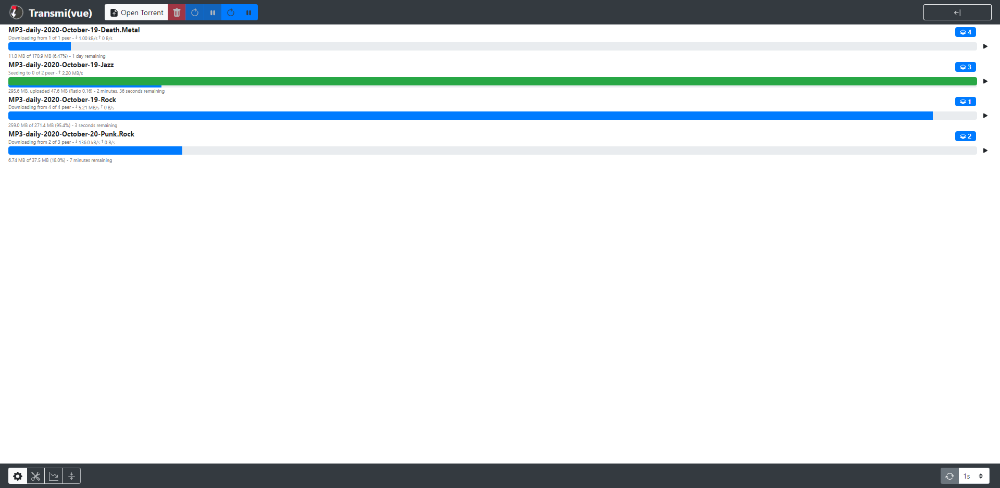
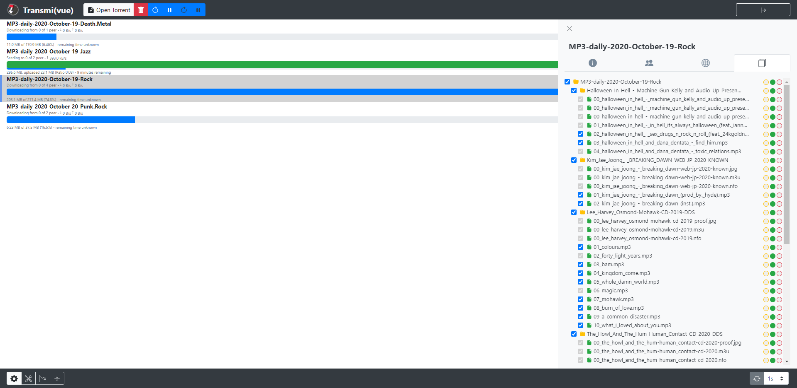
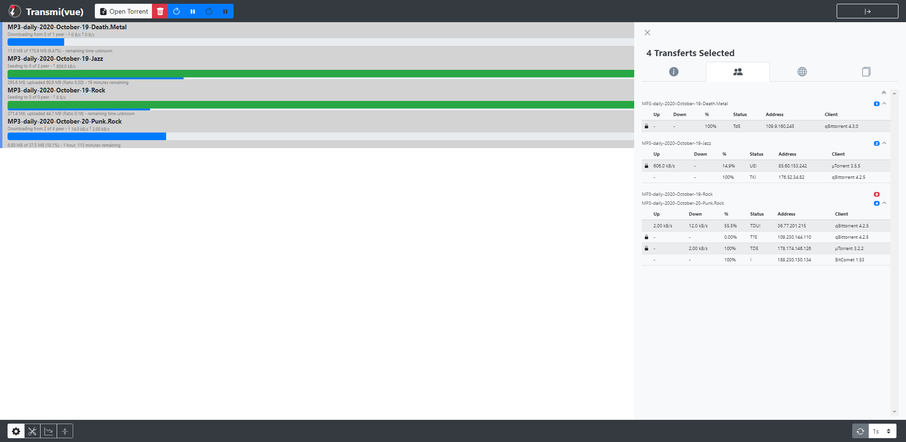

# Transmi(vue)

Transmi(vue) est une interface web pour piloter un client BitTorrent
[Transmission](https://transmissionbt.com/). L’application affiche les torrents
et leurs détails, et communique avec Transmission via son API RPC.

## Captures d’écran



| Panneau de détails | Peers |
| --- | --- |
|  |  |

## Technologies principales

- Vue.js 3.5
- Vuex 4.1
- Vue I18n 9.14
- Bootstrap 5.3 et BootstrapVueNext 1.2
- Vite 7.1
- Vitest 5
- Axios 1.20
- Node.js 22.12+, 24.x ou 26+

## Développement local

Installez une version de Node.js prise en charge, puis les dépendances :

```sh
npm ci
```

Configurez la cible Transmission dans `vite.config.js`, dans
`server.proxy['/api'].target` (par exemple `http://localhost:9091`).
Le proxy transmet les requêtes `/api` à `/transmission/rpc`.

Démarrez le serveur de développement :

```sh
npm run serve
```

Vite affiche l’adresse locale dans le terminal. Pour les autres commandes :

```sh
npm run build       # Générer la version de production dans dist/
npm run lint        # Vérifier le code
npm run test:unit   # Lancer les tests unitaires
```

Les langues peuvent être définies avec les variables d’environnement
`VITE_I18N_LOCALE` et `VITE_I18N_FALLBACK_LOCALE` (anglais par défaut).

## Déploiement avec Docker

L’image Docker est publiée sur [Docker Hub](https://hub.docker.com/r/nibelungens/transmi-vue).
Elle sert l’application sur le port `80` et utilise Nginx pour transmettre
les requêtes `/api` à `/transmission/rpc` sur le serveur Transmission.

Définissez `URL_TRANSMISION` avec l’adresse du serveur Transmission (hôte et
port, sans chemin), puis démarrez le conteneur :

```sh
docker run -d --name transmi-vue \
  -e URL_TRANSMISION=http://transmission:9091 \
  -p 8080:80 \
  nibelungens/transmi-vue:latest
```

Le fichier [`compose/docker-compose.yml`](compose/docker-compose.yml) fournit
un exemple prêt à configurer avec Transmission. Il utilise les variables
`HOST_API`, `PORT_API`, `PORT_HTTP`, `CONFIG_VOL`, `DOWNLOAD_VOL` et
`WATCH_VOL`. Les journaux Nginx peuvent être persistés en montant un volume sur
`/logs`.

## Documentation développeur

- [Guide Vue.js](https://vuejs.org/guide/)
- [Guide Vite](https://vite.dev/guide/)
- [Spécification RPC de Transmission](https://github.com/transmission/transmission/blob/main/docs/rpc-spec.md)
